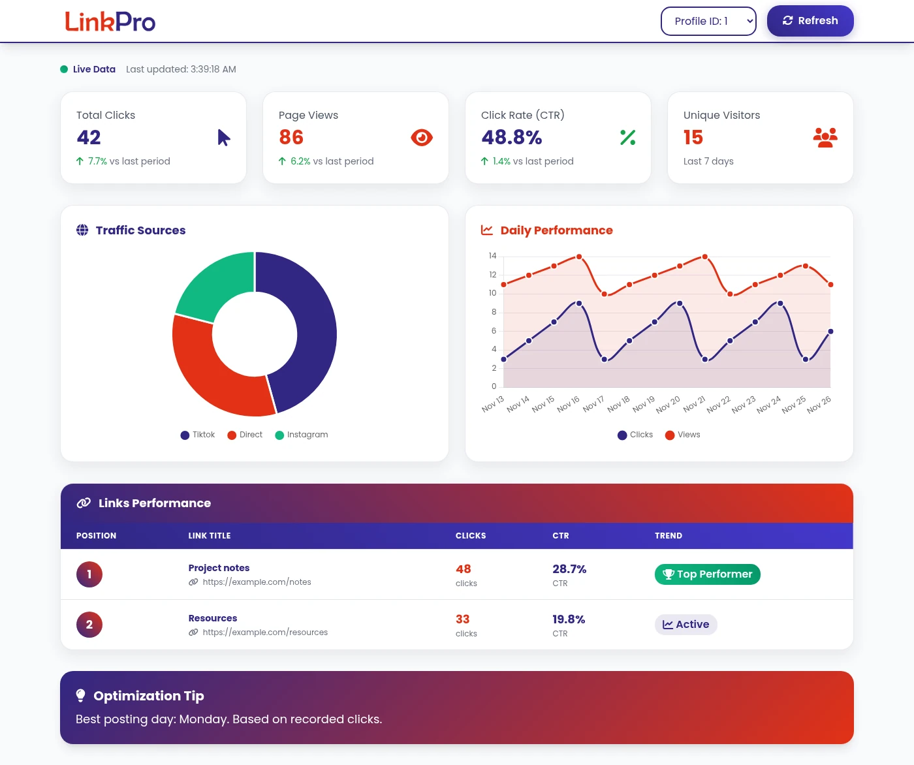

# LinkPro Analytics

I built LinkPro Analytics during my 2025 internship as a data science engineering student. The project records clicks and page views on link profiles and explores how engagement varies by link, traffic source, and time.

## Application

FastAPI records events and queries PostgreSQL through SQLAlchemy. The dashboard uses JavaScript, Chart.js, and Tailwind CSS to display seven-day totals, period comparisons, traffic sources, and link performance. It fetches fresh data every 30 seconds. Its posting suggestion shows the weekday with the most recorded clicks in the time series.

The screenshot shows the dashboard with synthetic events. The setup guide covers Python 3.12, PostgreSQL, the demo data, and the notebook. [Local setup](docs/SETUP.md)

## Posting-time analysis

I used a Jupyter notebook to explore clicks and views, run statistical tests, and compare regression and classification models. The notebook uses an 80/20 chronological train/test split and ranks candidate posting times using model scores and rules based on the exploratory analysis.

In the saved run, Lasso had a test R² of −0.0001 and logistic regression had a test ROC AUC of 0.5096. The models showed limited predictive signal on that test set. The notebook keeps the aggregate figures and results. The original event data and trained models are excluded. [Notebook and figures](recommendation_system/RecommendationSystem.ipynb)

## Repository structure

- `backend/` contains the API, database models, and analytics queries.
- `frontend/` contains the dashboard.
- `recommendation_system/` contains the analysis notebook and its dependencies.
- `docs/` contains setup instructions, synthetic sample data, and the dashboard screenshot.

The API runs locally and has no authentication. Tracking records IP addresses, user agents, and referrers, so use synthetic or approved data.
